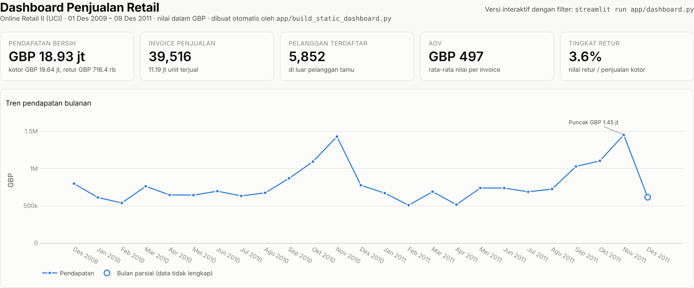
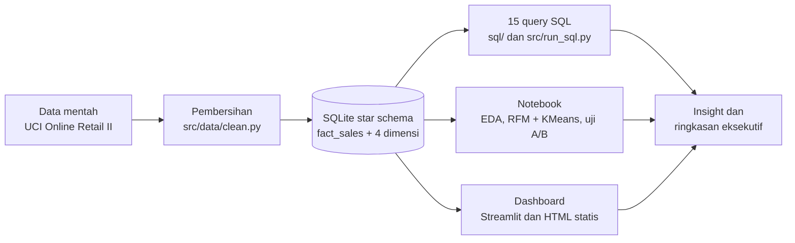
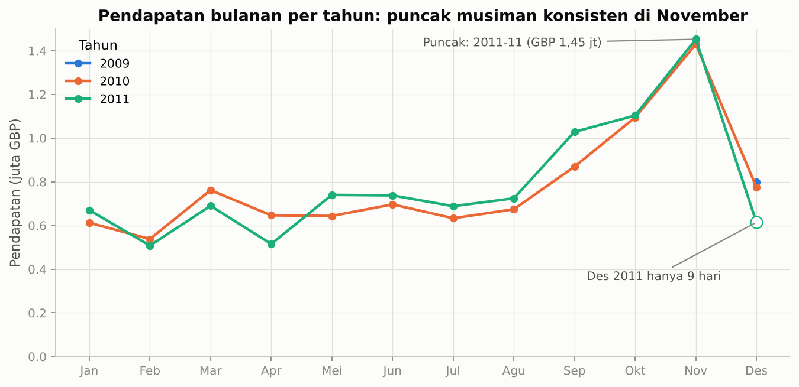
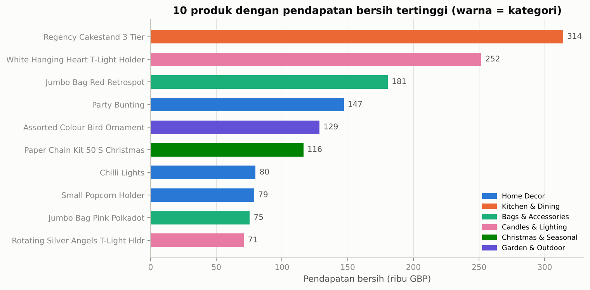
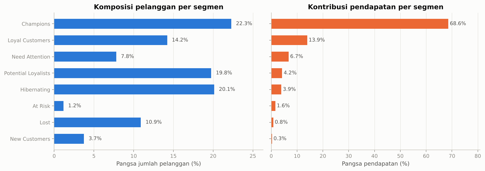
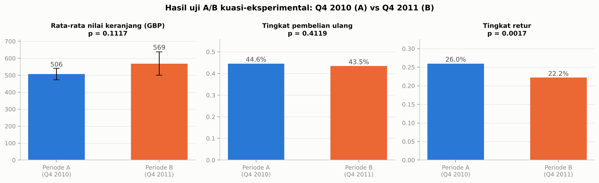
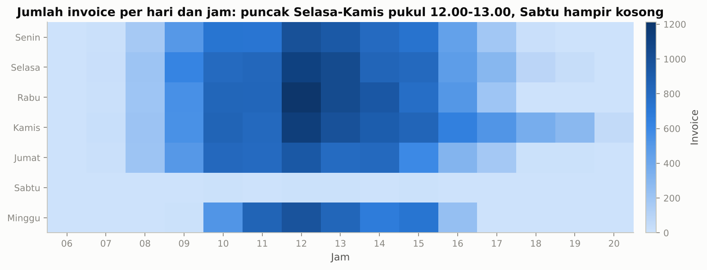
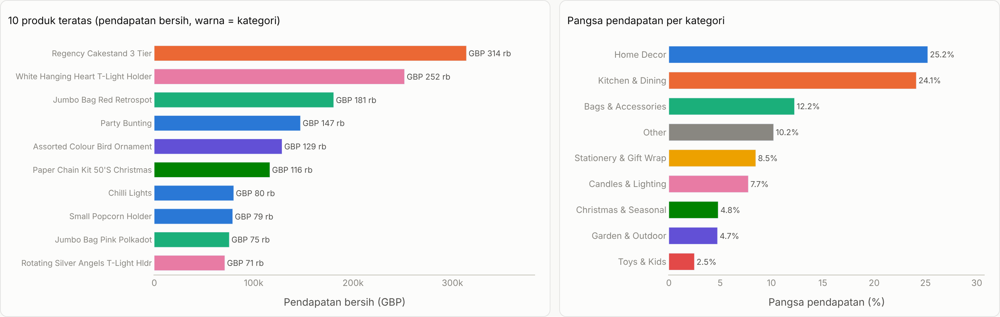

# Analisis Penjualan Retail: SQL, Star Schema, RFM, Uji A/B, dan Dashboard

Proyek analisis data end-to-end pada 1 juta transaksi peritel online (dataset publik Online Retail II), dari pembersihan data dan data warehouse SQLite berskema bintang, 15 query SQL analitik, segmentasi pelanggan RFM + KMeans, uji A/B, hingga dashboard interaktif dan panduan Power BI.




## Daftar Isi

- [Latar Belakang dan Pertanyaan Bisnis](#latar-belakang-dan-pertanyaan-bisnis)
- [Dataset](#dataset)
- [Metodologi](#metodologi)
- [Hasil Utama](#hasil-utama)
- [Struktur Folder](#struktur-folder)
- [Cara Menjalankan](#cara-menjalankan)
- [Teknologi](#teknologi)
- [Keterbatasan dan Pengembangan Lanjutan](#keterbatasan-dan-pengembangan-lanjutan)
- [Lisensi](#lisensi)
- [Kontak](#kontak)

## Latar Belakang dan Pertanyaan Bisnis

Seorang peritel online berbasis Inggris yang menjual hadiah dan perlengkapan rumah ke pembeli grosir ingin memahami bisnisnya lebih dalam dari sekadar total penjualan. Proyek ini menjawab pertanyaan yang biasa diajukan manajemen kepada seorang Data/BI Analyst:

| Area | Pertanyaan |
|---|---|
| Kinerja | Berapa pendapatan bersih setelah retur, dan bagaimana trennya bulan ke bulan dan tahun ke tahun? |
| Musiman | Kapan puncak penjualan, dan seberapa besar ketergantungan pada musim Natal? |
| Produk | Produk dan kategori mana yang menghasilkan uang? Berapa persen katalog yang benar-benar penting (Pareto 80/20)? |
| Pelanggan | Siapa pelanggan paling bernilai, siapa yang mulai hilang (segmentasi RFM), dan berapa persen pelanggan baru yang kembali (cohort)? |
| Pasar | Negara mana yang menjanjikan di luar UK, dan apakah pola pesanannya berbeda? |
| Operasional | Kapan pesanan masuk (hari/jam) dan di kategori mana retur paling tinggi? |
| Keputusan | Apakah musim puncak 2011 lebih baik dari 2010 secara statistik, bukan sekadar terlihat lebih tinggi? |

Daftar lengkap 16 pertanyaan beserta file SQL dan angka jawabannya ada di [`docs/pertanyaan_bisnis.md`](docs/pertanyaan_bisnis.md).

## Dataset

- **Sumber**: Chen, D. (2019). *Online Retail II* [Dataset]. UCI Machine Learning Repository, https://doi.org/10.24432/C5CG6D. Diunduh otomatis oleh `src/data/download.py`.
- **Lisensi**: Creative Commons Attribution 4.0 (CC BY 4.0).
- **Ukuran**: 1.067.371 baris transaksi, 1 Desember 2009 - 9 Desember 2011, 43 negara, 5.942 ID pelanggan. File asli (45 MB zip / 104 MB CSV) tidak dikomit; sampel 5.000 baris tersedia di [`data/raw/sample/`](data/raw/sample/).
- **Setelah pembersihan**: 1.003.214 baris penjualan dan 17.914 baris retur (6,0% baris mentah dibuang: duplikat, kode non-produk, harga nol). Rincian di [`docs/metodologi.md`](docs/metodologi.md).

Ringkasan kamus data (lengkap di [`docs/data_dictionary.md`](docs/data_dictionary.md)):

| Kolom | Arti |
|---|---|
| `invoice_no` | Nomor invoice; awalan `C` = pembatalan/retur |
| `stock_code`, `description` | Kode dan nama produk; kategori ditambahkan lewat pemetaan kata kunci |
| `quantity`, `unit_price`, `line_total` | Unit, harga satuan (GBP), dan nilai baris |
| `invoice_date` | Tanggal dan jam transaksi |
| `customer_id` | ID pelanggan; kosong pada 23% baris (dipertahankan sebagai pelanggan tamu) |
| `country` | Negara pelanggan |

## Metodologi



1. **Pembersihan** (`src/data/clean.py`): hapus duplikat persis (termasuk tumpang tindih dua sheet sumber), buang kode non-produk (ongkos kirim, penyesuaian manual) dan harga nol, pisahkan retur (invoice `C`) dari penjualan, pertahankan pelanggan tamu.
2. **Warehouse** (`src/data/build_warehouse.py`): star schema `fact_sales`, `dim_product` (dengan 9 kategori berbasis kata kunci), `dim_customer`, `dim_date`, `dim_store`. Diagram di [`docs/skema_star.md`](docs/skema_star.md).
3. **SQL analitik** (`sql/01` - `sql/15`): dari agregasi dasar sampai window function, cohort, Pareto, dan RFM; setiap file berisi pertanyaan bisnis, logika, dan insight.
4. **Notebook**: [`01_eda`](notebooks/01_eda.ipynb) eksplorasi dan validasi pembersihan; [`02_segmentasi_rfm`](notebooks/02_segmentasi_rfm.ipynb) skor RFM, segmen bernama, KMeans dengan pemilihan k lewat silhouette; [`03_uji_ab_promosi`](notebooks/03_uji_ab_promosi.ipynb) uji t Welch, chi-square, interval kepercayaan, Cohen's d, bootstrap, uji A/A, dan analisis power.
5. **Dashboard**: `app/dashboard.py` (Streamlit, filter periode/negara/kategori) dan `app/build_static_dashboard.py` (HTML Plotly + screenshot otomatis).

## Hasil Utama

| KPI (1 Des 2009 - 9 Des 2011) | Nilai |
|---|---|
| Pendapatan kotor | GBP 19,64 juta |
| Nilai retur | GBP 0,72 juta (3,6%) |
| **Pendapatan bersih** | **GBP 18,93 juta** |
| Invoice penjualan | 39.516 |
| Pelanggan terdaftar | 5.875 |
| Produk terjual | 4.721 kode stok |
| Nilai pesanan rata-rata (AOV) | GBP 497 (median GBP 301) |
| YTD November 2011 vs 2010 | +3,0% |

**Insight terpenting**

1. **Musiman ekstrem dan berulang**: November menghasilkan GBP 1,43 juta (2010) dan GBP 1,45 juta (2011), hampir tiga kali bulan terendah (Feb 2011, GBP 0,51 juta). Sep-Nov menyumbang 36-38% pendapatan tahunan.
2. **Pelanggan inti sangat terkonsentrasi**: segmen Champions (1.304 pelanggan, 22%) menyumbang 68,6% pendapatan pelanggan terdaftar; KMeans (k = 2, silhouette 0,44) mengonfirmasi 40% pelanggan inti menghasilkan 88% pendapatan. 31% pelanggan sudah tidak belanja lebih dari setahun.
3. **Pareto produk**: 1.029 produk (21,9% katalog) menghasilkan 80% pendapatan; separuh katalog (2.417 produk) hanya 5%.
4. **Pasar ekspor memesan lebih besar**: UK = 85,5% pendapatan, tetapi AOV Eropa GBP 821 dan luar Eropa GBP 1.281 vs UK GBP 464 (Belanda GBP 2.545).
5. **Retensi rendah**: hanya 20,2% pelanggan baru kembali pada bulan berikutnya; kohort yang masuk saat musim puncak paling jarang kembali (5-15%).

**Uji A/B (kuasi-eksperimen) musim puncak Q4 2010 (A) vs Q4 2011 (B)**

| Metrik | A | B | Uji | p-value | Kesimpulan |
|---|---|---|---|---|---|
| Rata-rata nilai keranjang | GBP 506 (n = 5.793) | GBP 569 (n = 5.572) | t Welch | 0,112 | Tidak signifikan; Cohen's d = 0,03; IK 95% selisih [-15; +140] |
| Tingkat pembelian ulang | 44,6% | 43,5% | chi-square | 0,412 | Tidak berbeda |
| Tingkat retur pelanggan | 26,0% | 22,2% | chi-square | 0,002 | Turun signifikan (-3,7 poin) |

Catatan penting: dataset tidak memuat eksperimen terkontrol, jadi notebook 03 menerapkan kerangka uji A/B pada dua periode yang sebanding dan menjelaskan keterbatasannya. Ringkasan satu halaman beserta rekomendasi bisnis ada di [`reports/ringkasan_eksekutif.md`](reports/ringkasan_eksekutif.md).

<details>
<summary>Gambar lain dari notebook dan dashboard</summary>

| | |
|---|---|
|  |  |
|  |  |
|  |  |

</details>

## Struktur Folder

```
analisis-penjualan-retail-sql-powerbi/
├── app/
│   ├── dashboard.py                 # dashboard Streamlit (filter, KPI, tab analisis)
│   └── build_static_dashboard.py    # dashboard HTML Plotly + screenshot Playwright
├── assets/                          # gambar untuk README (PNG hasil notebook/dashboard)
├── data/
│   ├── raw/sample/                  # sampel 5.000 baris data mentah (file penuh diabaikan git)
│   └── processed/                   # parquet bersih dan retail_dw.sqlite (dibangun ulang, diabaikan git)
├── docs/
│   ├── data_dictionary.md           # kamus data mentah, bersih, dan warehouse
│   ├── skema_star.md                # diagram ER Mermaid dan keputusan desain
│   ├── pertanyaan_bisnis.md         # 16 pertanyaan, file SQL, insight dengan angka
│   ├── metodologi.md                # alasan di balik tiap langkah
│   └── panduan_power_bi.md          # koneksi SQLite/CSV ke Power BI & Tableau, model relasi, DAX
├── notebooks/
│   ├── 01_eda.ipynb                 # eksplorasi data (output tersimpan)
│   ├── 02_segmentasi_rfm.ipynb      # RFM + KMeans (silhouette)
│   └── 03_uji_ab_promosi.ipynb      # uji t Welch, chi-square, IK, Cohen's d, power
├── reports/
│   ├── ringkasan_eksekutif.md       # insight utama dan rekomendasi (1 halaman)
│   ├── dashboard.html               # dashboard statis
│   ├── rfm_segments.csv             # segmen per pelanggan
│   └── sql_output/                  # CSV hasil tiap query + _indeks.md
├── sql/                             # 15 query bernomor, dari dasar ke lanjut
├── src/
│   ├── config.py                    # path terpusat
│   ├── data/                        # download.py, clean.py, categorize.py, build_warehouse.py
│   ├── analysis/                    # rfm.py, ab_test.py
│   ├── dashboard_data.py            # agregasi bersama kedua dashboard
│   ├── dashboard_figures.py         # figur Plotly bersama
│   ├── run_sql.py                   # eksekusi semua query -> CSV
│   └── viz.py                       # palet warna dan gaya grafik
├── tests/                           # 47 pytest: pembersihan, kategori, warehouse, RFM, A/B, SQL
├── .github/workflows/ci.yml         # ruff + pytest pada Python 3.12
├── Makefile, run_all.sh             # pipeline dari nol
├── requirements.txt, pyproject.toml
├── CHANGELOG.md, CONTRIBUTING.md, LICENSE
└── README.md
```

## Cara Menjalankan

Prasyarat: Python 3.12 atau lebih baru, git, koneksi internet untuk mengunduh dataset (45 MB).

```bash
# 1. Clone dan masuk ke folder proyek
git clone https://github.com/imman20/analisis-penjualan-retail-sql-powerbi.git
cd analisis-penjualan-retail-sql-powerbi

# 2. Buat lingkungan virtual dan pasang dependensi
python -m venv .venv
source .venv/bin/activate          # Windows: .venv\Scripts\activate
pip install -r requirements.txt

# 3. Jalankan seluruh pipeline (unduh -> bersihkan -> warehouse -> SQL -> notebook -> dashboard -> tes)
bash run_all.sh                    # atau: make all

# Atau tahap per tahap
python -m src.data.download        # unduh dan konversi dataset ke CSV
python -m src.data.clean           # pembersihan -> data/processed/*.parquet
python -m src.data.build_warehouse # star schema -> data/processed/retail_dw.sqlite
python -m src.run_sql              # 15 query -> reports/sql_output/
python -m jupyter nbconvert --execute --to notebook --inplace notebooks/01_eda.ipynb
python -m jupyter nbconvert --execute --to notebook --inplace notebooks/02_segmentasi_rfm.ipynb
python -m jupyter nbconvert --execute --to notebook --inplace notebooks/03_uji_ab_promosi.ipynb
python -m app.build_static_dashboard   # reports/dashboard.html + assets/dashboard_*.png

# 4. Uji dan lint
ruff check .
python -m pytest

# 5. Dashboard interaktif
streamlit run app/dashboard.py
```

Screenshot dashboard memerlukan Chromium. Jika belum ada, jalankan `playwright install chromium` sekali, atau arahkan variabel lingkungan `CHROMIUM_PATH` ke binari Chromium yang sudah terpasang; tanpa Chromium, skrip tetap menghasilkan `reports/dashboard.html` dan melewati screenshot.

Untuk membuka warehouse di Power BI atau Tableau, ikuti [`docs/panduan_power_bi.md`](docs/panduan_power_bi.md) (koneksi ODBC/CSV, model relasi, dan ukuran DAX seperti `Total Sales`, `YoY Growth`, `AOV`).

## Teknologi

| Kebutuhan | Alat |
|---|---|
| Pengolahan data | Python 3.12+, pandas, NumPy, PyArrow, openpyxl |
| Data warehouse | SQLite (star schema), SQL dengan CTE dan window function |
| Statistik dan ML | SciPy, statsmodels, scikit-learn (KMeans, silhouette) |
| Visualisasi | matplotlib, Plotly |
| Dashboard | Streamlit; HTML statis + Playwright untuk screenshot |
| BI | Power BI / Tableau (panduan koneksi dan DAX) |
| Kualitas kode | pytest (47 tes), ruff, GitHub Actions CI |

## Keterbatasan dan Pengembangan Lanjutan

**Keterbatasan**

- Data berakhir 9 Desember 2011; Desember 2011 bersifat parsial dan selalu ditandai di grafik dan query.
- Kategori produk ditetapkan dari kata kunci deskripsi; 10% pendapatan jatuh ke "Other".
- `dim_store` memodelkan wilayah pasar karena dataset berasal dari satu toko online.
- Uji A/B bersifat kuasi-eksperimental (dua periode, tanpa randomisasi); perbedaan bisa dipengaruhi faktor lain.
- Tidak ada data biaya, sehingga analisis berhenti di pendapatan, bukan margin.
- File `.pbix` tidak disertakan; laporan Power BI dibangun manual mengikuti panduan di `docs/`.

**Pengembangan lanjutan**

- Peramalan permintaan bulanan (SARIMA/Prophet) untuk perencanaan stok kuartal puncak.
- Model prediksi churn berbasis fitur RFM dan cohort.
- Analisis keranjang belanja (association rules) untuk rekomendasi bundel produk.
- Migrasi warehouse ke PostgreSQL/DuckDB dan orkestrasi dengan dbt.
- Penyempurnaan kategori produk dengan model klasifikasi teks.

## Lisensi

Kode dan dokumentasi dirilis di bawah [Lisensi MIT](LICENSE). Dataset Online Retail II berlisensi CC BY 4.0 (UCI Machine Learning Repository).

## Kontak

**Immantaka Juniarsa** - S1 Statistika, Universitas Airlangga (2024)

- GitHub: [imman20](https://github.com/imman20)
- Email: immantakajuniarsa30@gmail.com
