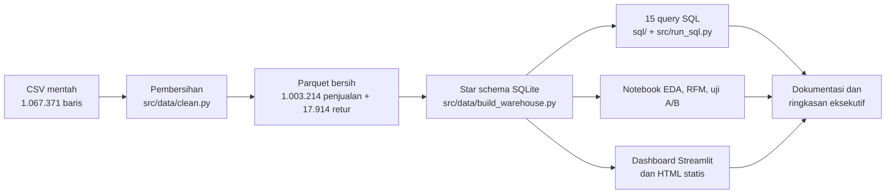

# Metodologi

Dokumen ini menjelaskan *mengapa* setiap langkah dilakukan seperti itu, bukan
hanya *apa* yang dilakukan. Kode yang dirujuk ada di `src/`, `sql/`, dan
`notebooks/`.

## 1. Alur kerja

## 2. Pengumpulan data

Dataset Online Retail II diunduh langsung dari UCI (`src/data/download.py`)
sebagai arsip zip berisi satu file Excel dengan dua sheet (Des 2009-Des 2010 dan
Des 2010-Des 2011). Kedua sheet digabung dan disimpan sebagai CSV supaya
pembacaan berikutnya memakan detik, bukan menit. Skrip bersifat idempoten agar
pipeline bisa dijalankan ulang tanpa mengunduh lagi.

## 3. Pembersihan (`src/data/clean.py`)

| Masalah | Jumlah baris | Penanganan | Alasan |
|---|---:|---|---|
| Duplikat persis | 34.335 | Dihapus | Termasuk 22.523 baris periode 1-9 Des 2010 yang muncul di kedua sheet sumber; sisanya duplikat dalam satu sheet yang hampir pasti artefak ekspor. |
| Kode stok non-produk (`POST`, `DOT`, `M`, `D`, `BANK CHARGES`, `AMAZONFEE`, `gift_*`, `TEST*`) | 5.980 | Dihapus | Ongkos kirim, penyesuaian manual, dan komisi bukan barang dagangan; aturannya: kode produk selalu 5 digit + maksimal 3 huruf. |
| Harga <= 0 atau deskripsi kosong | 5.928 | Dihapus | 99% tanpa ID pelanggan, berisi catatan internal ("check", "damages", "?"). |
| Kuantitas negatif tanpa invoice `C` | 0 setelah langkah di atas | Dihapus bila ada | Penyesuaian stok internal, bukan retur pelanggan. |
| Invoice berawalan `C` | 17.914 | Dipisah sebagai retur | Agar pendapatan kotor, nilai retur, dan pendapatan bersih bisa dihitung terpisah. |
| Customer ID kosong | 226.637 (22,6% penjualan bersih) | Dipertahankan sebagai tamu | Tetap penjualan nyata (13,1% pendapatan); hanya analisis per pelanggan yang mengecualikannya. |

Keputusan yang sengaja **tidak** diambil: memotong pencilan kuantitas/harga.
Pesanan 80.995 unit adalah transaksi nyata yang dibatalkan di hari yang sama;
karena retur ikut dimodelkan, nilai bersihnya otomatis nol. Memotong pencilan
akan menyembunyikan fenomena yang justru penting untuk dilaporkan (lihat
`sql/14_tingkat_retur.sql`).

## 4. Kategori produk (`src/data/categorize.py`)

Dataset tidak punya kategori. Saya membuat 9 kategori berbasis kata kunci pada
deskripsi dengan aturan berurutan (yang spesifik seperti "CHRISTMAS" diperiksa
sebelum yang umum seperti "DECORATION"). Kelebihannya: dapat diaudit dan diuji
(`tests/test_categorize.py`). Kekurangannya: 716 produk (10,2% pendapatan)
jatuh ke "Other". Kategori ditetapkan per **kode stok** (deskripsi yang paling
sering muncul), bukan per baris, agar satu produk selalu punya satu kategori.

## 5. Pemodelan warehouse

Lihat `docs/skema_star.md`. Ringkasnya: tabel fakta grain item-per-invoice
dengan flag `is_return`, empat dimensi dengan surrogate key, kalender penuh,
dan `dim_store` yang memodelkan wilayah pasar karena dataset berasal dari satu
toko online.

## 6. Analisis SQL

Lima belas query disusun dari dasar ke lanjut agar bisa dibaca sebagai
portofolio keterampilan SQL: agregasi, JOIN/GROUP BY/HAVING, subquery, CTE,
window function (`RANK`, `LAG`, running `SUM`, `PERCENT_RANK`, `NTILE`), cohort
retensi, Pareto/ABC, RFM, dan fungsi tanggal. Setiap file diawali komentar:
pertanyaan bisnis, logika, dan insight dengan angka hasil. `src/run_sql.py`
menjalankan semuanya dan menyimpan CSV serta indeks markdown; `tests/test_sql.py`
memastikan setiap query tetap valid terhadap skema.

Dua konvensi penting:

- Perbandingan tahunan memakai **periode yang disamakan** (1 Jan - 9 Des)
  karena data 2011 berakhir 9 Desember.
- Peringkat produk memakai **pendapatan bersih** (penjualan dikurangi retur).

## 7. Segmentasi RFM (`src/analysis/rfm.py`, notebook 02)

- Recency dihitung terhadap tanggal acuan 10 Des 2011 (sehari setelah data
  berakhir); frequency = jumlah invoice unik; monetary = total nilai penjualan.
- Skor 1-5 per dimensi memakai kuintil dengan `rank(method="first")` supaya
  `qcut` tidak gagal pada ribuan nilai kembar (frequency = 1). Di SQL dipakai
  `NTILE(5)`. Keduanya menghasilkan kuintil, tetapi memecah nilai kembar dengan
  urutan berbeda sehingga jumlah per segmen berbeda tipis (Champions 1.304 vs
  1.355). Aturan pemetaan skor ke segmen identik di kedua implementasi.
- KMeans dijalankan pada `log1p(R, F, M)` yang distandardisasi karena F dan M
  sangat miring; tanpa log, KMeans hanya memisahkan beberapa pembeli grosir
  raksasa. Jumlah klaster dipilih dengan skor silhouette (k = 2..8, hasil
  terbaik k = 2 dengan 0,44); k = 4 ditampilkan sebagai alternatif yang lebih
  praktis secara operasional.

## 8. Uji A/B kuasi-eksperimental (`src/analysis/ab_test.py`, notebook 03)

Dataset tidak memuat eksperimen terkontrol, maka saya menerapkan kerangka uji
A/B pada dua periode musim puncak yang sebanding: 1 Okt - 9 Des 2010 (A) vs
1 Okt - 9 Des 2011 (B). Hal ini dinyatakan terang-terangan di notebook dan README
agar tidak disalahartikan sebagai eksperimen sungguhan.

| Metrik | Unit | Uji | Alasan pemilihan |
|---|---|---|---|
| Rata-rata nilai keranjang | invoice | t Welch dua sisi, IK 95%, Cohen's d, bootstrap 5.000 ulangan, uji pada skala log | Varians kedua periode berbeda; distribusi miring sehingga bootstrap dan log menjadi pemeriksaan ketahanan. |
| Tingkat pembelian ulang (>= 2 invoice) | pelanggan terdaftar | chi-square 2x2 tanpa koreksi Yates, IK Wald | Sampel ribuan, proporsi jauh dari 0/1. |
| Tingkat retur (>= 1 invoice retur) | pelanggan terdaftar | chi-square 2x2 | Sama seperti di atas. |

Pengaman tambahan: uji A/A (periode A dibagi acak menjadi dua) untuk memastikan
tidak ada positif palsu, dan analisis power (`statsmodels.TTestIndPower`) untuk
menyatakan efek minimum yang bisa dideteksi.

## 9. Visualisasi

Palet warna tunggal didefinisikan di `src/viz.py` dan dipakai oleh matplotlib
(notebook) maupun Plotly (dashboard): urutan warna kategorikal tetap, kategori
"Other" selalu abu-abu, ramp satu warna untuk heatmap, dan satu sumbu y per
grafik. Bulan parsial (Des 2011) selalu ditandai agar tidak terbaca sebagai
penurunan.

## 10. Reproduksibilitas dan pengujian

- `run_all.sh` / `make all` menjalankan seluruh pipeline dari nol.
- Semua fungsi pembersihan, pemodelan, RFM, dan uji statistik murni (menerima
  dan mengembalikan DataFrame/array) sehingga diuji dengan pytest tanpa
  memerlukan data penuh (47 tes, fixture kecil buatan tangan).
- CI GitHub Actions menjalankan `ruff check` dan `pytest` pada Python 3.12.
- Seed tetap (`random_state=42`, `default_rng(42)`) pada KMeans dan bootstrap.

## 11. Keterbatasan

- Data berhenti 9 Des 2011 dan hanya mencakup dua musim puncak penuh.
- Kategori berbasis kata kunci tidak sempurna ("Other" 10%).
- `dim_store` adalah wilayah pasar, bukan toko fisik.
- Uji A/B bersifat kuasi-eksperimental; perbedaan antar periode bisa dipengaruhi
  faktor di luar kampanye, dan unit invoice tidak sepenuhnya independen
  (satu pelanggan banyak invoice).
- Tidak ada data biaya, sehingga analisis hanya sampai pendapatan, bukan margin.
