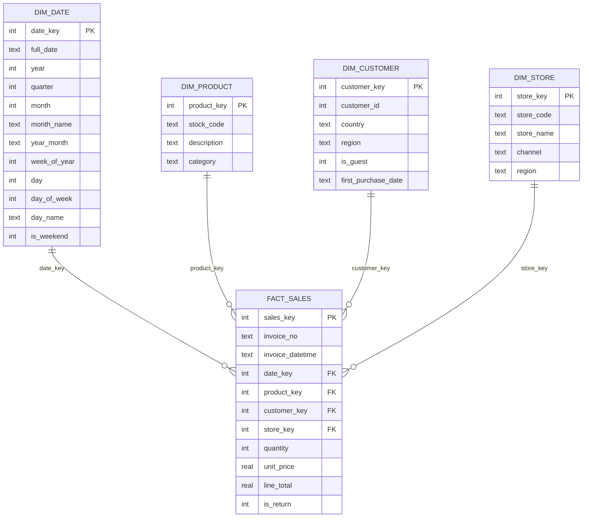

# Skema Star Data Warehouse

Warehouse dibangun oleh `src/data/build_warehouse.py` ke file SQLite
`data/processed/retail_dw.sqlite` (sekitar 138 MB; tidak dikomit, dibangun
ulang dengan `make warehouse`).

## Diagram

## Ukuran tabel (hasil build)

| Tabel | Baris | Keterangan |
|---|---:|---|
| `fact_sales` | 1.021.128 | 1.003.214 baris penjualan + 17.914 baris retur |
| `dim_product` | 4.721 | satu baris per kode stok |
| `dim_customer` | 5.890 | 5.875 pelanggan terdaftar + 15 baris tamu (satu per negara) |
| `dim_date` | 761 | kalender harian 1 Des 2009 - 31 Des 2011 |
| `dim_store` | 3 | wilayah pasar: UK, Eropa, luar Eropa |

## Keputusan desain

**Grain tabel fakta** adalah satu baris per item per invoice. Ini grain paling
halus yang tersedia, sehingga semua agregasi (per invoice, per hari, per
pelanggan) bisa diturunkan tanpa kehilangan informasi.

**Retur disimpan di tabel fakta yang sama** dengan `is_return = 1` dan
`quantity`/`line_total` negatif. Keuntungannya: `SUM(line_total)` langsung
menghasilkan pendapatan bersih, sedangkan filter `is_return = 0` memberi
pendapatan kotor. Alternatifnya (tabel `fact_returns` terpisah) membuat setiap
query pendapatan bersih memerlukan `UNION`.

**Pelanggan tamu** (23% baris tanpa Customer ID) tidak dibuang. Mereka
dimodelkan sebagai satu baris `dim_customer` per negara dengan `is_guest = 1`,
sehingga pendapatan per negara tetap lengkap dan analisis per pelanggan tinggal
memfilter `is_guest = 0`.

**`dim_store`** memerlukan penjelasan jujur: dataset asli berasal dari satu toko
online, tanpa kolom toko atau kanal. Dimensi ini memodelkan *wilayah pasar*
(domestik UK, Eropa, luar Eropa) yang diturunkan dari negara pelanggan. Tujuannya
agar skema sudah siap menerima data multi-toko/multi-kanal tanpa mengubah tabel
fakta, dan agar dashboard punya filter kanal yang masuk akal.

**Surrogate key integer** (`*_key`) dipakai di semua dimensi, bukan kunci
alami (`stock_code`, `customer_id`), supaya JOIN cepat dan dimensi bisa
berubah (mis. deskripsi produk diperbarui) tanpa menyentuh tabel fakta.

**`date_key` berformat YYYYMMDD** (mis. `20111209`) agar mudah dibaca manusia
dan bisa dibandingkan langsung dengan operator `<`/`>` tanpa konversi tanggal.

## Indeks

Indeks dibuat pada semua foreign key di `fact_sales` dan pada `invoice_no`.
Dengan indeks ini seluruh 15 query di `sql/` selesai dalam 0,6-3,1 detik pada
laptop biasa (lihat `reports/sql_output/_indeks.md`).
